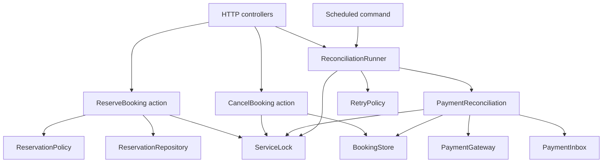

# SOLID structure and design patterns

This is a pragmatic Laravel design. Eloquent remains the model representation, and simple admin/read queries use Eloquent directly. The concurrency-sensitive use cases depend on small persistence and locking contracts. There is no generic repository hierarchy or interface for every class.

## Responsibilities and dependencies

`AppServiceProvider` is the composition root: it binds contracts to implementations. Controllers receive the action they need through constructor/method injection. The scheduled command receives its runner and inbox through Laravel's container.

| Principle | Application |
| --- | --- |
| Single responsibility | `ReserveBooking` handles reservation; `CancelBooking` records cancellation intent; `Reconciler` performs one synchronization; `ReconciliationRunner` records failures and schedules retries. SQL, locking, and business rules have separate owners. |
| Open/closed | A different `PaymentGateway`, `RetryPolicy`, or persistence implementation can be bound without changing the use-case orchestration. |
| Liskov substitution | Contract comments specify semantic requirements, not just signatures. Every gateway must provide idempotent creation and immutable terminal outcomes; every `ServiceLock` must provide atomic commit/rollback using the repositories' connection. A replacement that omits these guarantees is invalid. |
| Interface segregation | Reservation lookups/creation use `ReservationRepository`; payment updates and cancellation use the smaller `BookingStore`. The provider simulator's `complete` operation is excluded from the production `PaymentGateway` contract. |
| Dependency inversion | Actions and reconciliation depend on repository, lock, inbox, payment, and retry contracts. SQL implementations live in `Repositories` and `Infrastructure`; logging uses PSR's `LoggerInterface`. |

Pure, stable policies such as `ReservationPolicy` and the `PaymentState` transition function remain concrete. They do not need interchangeable implementations today. Eloquent model coupling is intentional; this is not a framework-independent domain model.

## Patterns used

| Pattern | Classes | Purpose |
| --- | --- | --- |
| Command-style actions | `ReserveBooking`, `CancelBooking` | Each action exposes one `execute` operation and can be called by HTTP, admin, or tests. These are synchronous application actions, not queued Laravel jobs. |
| Repository | `ReservationRepository`, `BookingStore`, `EloquentBookingRepository` | Keep SQL and persistence details outside the booking/payment orchestration. One adapter implements the two focused contracts. |
| Strategy | `RetryPolicy`, `ExponentialBackoff` | Replace retry timing independently; tests inject a fixed delay to verify scheduling. |
| Adapter | `PaymentGateway`, `LocalPaymentGateway` | Isolate provider-specific operations. An external provider adapter must satisfy the same documented guarantees. |
| Transaction callback / unit-of-work boundary | `ServiceLock`, `DatabaseServiceLock` | Own the transaction and first-write service lock in one place. All reservation and payment-state writes use this boundary. |
| Durable inbox | `PaymentInbox`, `DatabasePaymentInbox` | Persist and deduplicate provider events, reject conflicting event IDs, and acknowledge events with local state changes. |
| Finite-state transition policy | `PaymentState` | Make terminal-state rules explicit and testable. This is a transition function, not a hierarchy of GoF State objects. |

## Correctness boundaries

`DatabaseServiceLock` begins a transaction and writes the service row before any inventory reads. Its callback receives a fresh service snapshot. Reservation creation and idempotency-key recording commit together. Repository interfaces alone do not provide concurrency safety: all inventory-sensitive access must occur inside this lock.

`Reconciler` reads provider state before entering the transaction, then reloads the booking under the lock before applying a transition. It acknowledges the inbox in the same transaction as the booking update. A worker that sees a terminal booking does not change it.

`ReconciliationRunner` locks and reloads the booking before recording failure metadata. If another worker already completed the booking, it leaves that terminal result and its metadata alone. The retry strategy reaches 300 seconds and remains capped there. A database failure that prevents retry metadata from being written is allowed to propagate; the original pending booking remains durable for a later scheduler pass.

Business conflicts throw `BookingConflict`, independent of HTTP. `bootstrap/app.php` maps that exception to HTTP 409. Policies and actions can therefore also run from CLI and unit tests without constructing HTTP exceptions.

## Tests and limits

Unit tests cover purchase-window boundaries, capacity decisions, lock ordering, idempotency, deadline capping, cancellation against a stale snapshot, provider I/O outside locks, concurrent terminal-state protection, and configurable retry timing. An inspecting lock test double checks ordering only; it does not pretend to test transaction isolation. The existing multi-process integration test remains responsible for validating actual database locking.

The refactor preserves routes, payloads, database schema, provider simulator, and scheduler command. Two recovery fixes accompany it: exponential backoff now reaches the documented 300-second cap, and stale failing workers no longer overwrite completed bookings' retry metadata.

The local environment still lacks `pdo_sqlite` and blocks MySQL sockets. Unit and HTTP smoke checks run here; database integration and concurrency tests must run using the documented Docker or CI setup.
